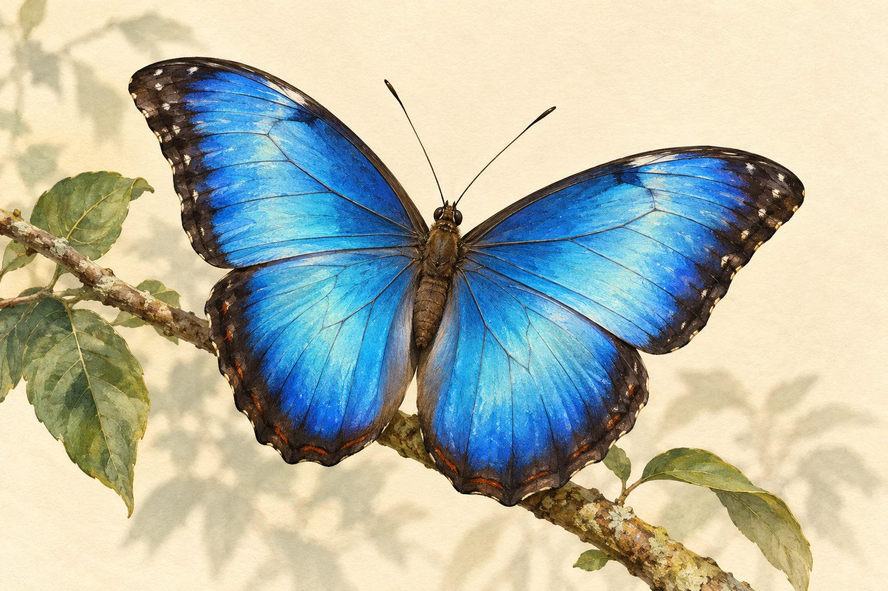
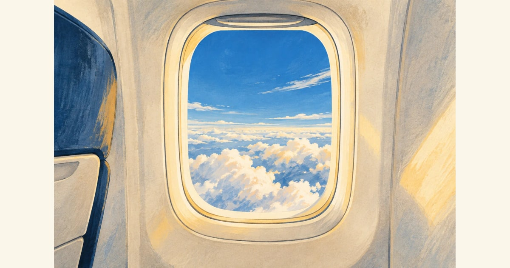

# Proposed visual direction — Five Minutes

Draft for visual and independent technical review; not a completed lesson or a final house style. Basis: #188, #190 and [ADR-0014](../adr/0014-positioned-lesson-visuals.md).

## Direction

Make the subject worth looking at: rich, carefully observed editorial illustration with fine edges, tactile colour and quiet space around it. Use a natural-history sensibility without copying an old plate or making every subject look antique. The artwork creates curiosity; the explanation earns it. Engineering and social subjects must work in the same family without borrowing biological imagery.

This first sample is expressive artwork, not a specimen photograph, species-identification reference or microscopic evidence. Its silhouette, colour and detail still need topic-specific review before any lesson use. The scientific diagram will be designed from sources separately; an attractive wing is not an explanation of its colour.

Use warm ivory `#fbf6ea`, dark ink `#202830`, cobalt `#175f9c`, muted teal `#316b69` and restrained ochre `#b88135` as a starting family. Let subjects supply other colours. Keep paper texture faint enough to compress and avoid interfering with labels. Artwork retains its colours in dark mode, on an intentional light frame; never invert it.

## Reference set and provenance

References were viewed and their museum records checked on 23 October 2026. The two historical works are labelled Public Domain by their holding museum. Their features inform the direction; neither image was supplied to the generator or copied into the illustration.

| Reference | Take from it | Rights/evidence |
| --- | --- | --- |
| [Hollar, Three Butterflies and a Wasp, 1646](https://www.metmuseum.org/art/collection/search/361547) | Fine contour, legible silhouette and space around the subject; not its aged paper or lettering. | Met object 26.72.120; Public Domain/Open Access record. |
| [Merian, Study of Capers, Gorse, and a Beetle, 1693](https://www.metmuseum.org/art/collection/search/399922) | Restrained background, observed detail and a focused colour accent; not a scientific claim about the pilot's organism. | Met object 2012.83; Public Domain/Open Access record. |
| [Generated aircraft, setup-02](references/scheduled-aircraft.webp) | Gouache/ink family applied to engineering; empty cabin scene with the window kept intact in a padded share image. | Original built-in generation, no source images; [trial ledger](scheduled-setup-02.json), conceptual artwork only. |
| Generated butterfly, setup-01 | A vivid contemporary interpretation and practical compression/crop reference. | Original text prompt, no input image; built-in image generation. Prompt, asset hash and basis in [setup-ledger.json](setup-ledger.json). |

Generation records the provider method and use subject to applicable [OpenAI Europe terms](https://openai.com/policies/eu-terms-of-use/). It establishes no guaranteed exclusivity, copyright protection or third-party/commercial clearance. A future published raster needs its own persistent `imageRights` record and factual review; this setup ledger is not a substitute.

## Practical rules

- Default to a 3:2 lead composition with breathing room around the subject. Preview it at 320 pixels, as a Library thumbnail and as a share image. Use contain/padding when a crop would cut a meaningful feature.
- Default to no generated lettering, logos, scales, graphs or explanatory arrows. Put exact labels in the diagram source and provide an equivalent plain-text description.
- Plan the lead and one or two purposeful explanatory visuals together. Three is a ceiling, not a quota. Draw the specific relationship rather than forcing it into a generic toolkit template. Code-drawn originals may be exported to PNG/WebP.
- Keep useful visual distinctions in greyscale and at enlarged text sizes. Provide alt, caption and a complete text explanation. Mark conceptual/not-to-scale content explicitly.

The complete generation prompt is in the ledger. Reuse its composition/medium constraints as guidance, replacing the subject and its factual constraints; do not paste it as a fixed template for every topic.

## Capability and resource record

Setup ceiling: **four dispatched generation requests**, shared across interactive and scheduled work, including failures and edits. Two requests have been dispatched: the interactive butterfly and the single scheduled aircraft trial. Two remain under the shared ceiling; no further generation was needed for this foundation. No calibration-lesson request has been spent. Do not interpret a new branch, run or date as a reset.

The interactive source optimises to **297,368 bytes**, WebP, **1536×1024**, with metadata stripped and container validation. Its 480×320 thumbnail is **23,496 bytes**. A 1200×630 centre-crop trial from the original textured artwork produced PNG **1,848,892 bytes** versus JPEG **174,482 bytes**. PNG exceeds the ceiling. Inspection also found the tighter crop undesirable, so the implemented contain/padded share derivative from the optimised source is JPEG **116,212 bytes**. See [the share trial](references/share-trial.jpg). These are different transforms, recorded explicitly rather than compared as identical encodings. The app prefers PNG for simpler artwork that fits.

The scheduled trial **passed the technical path**, including local bytes, optimisation, current-main parser validation and Git submission: [setup-02 evidence](scheduled-setup-02.json), [commit 740acab](https://github.com/nunov00/five-minutes/commit/740acab42095e13ba16a2ec1677f17604baccc49). Its 1536×1024 WebP is 241,710 bytes. The centre crop clips upper window corners, so the share reference uses the same contain/padding treatment as the application. This establishes asset production, not lesson publication or scientific accuracy. The Publisher remains disabled. Browser evidence belongs on the implementation PR.

The padded derivative preserves both rounded upper corners; the plain centre crop is deliberately not used.

Renderer fixtures serve the documentation source only in the explicit test build. It is absent from normal production output. Card thumbnails and share images both use contain/padding; portrait artwork is preserved too.
